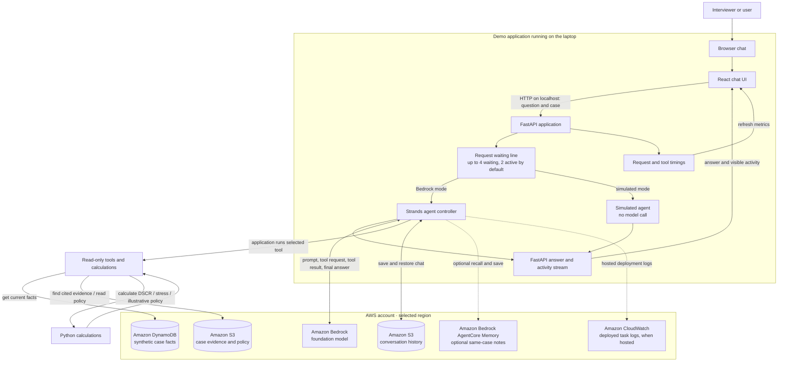
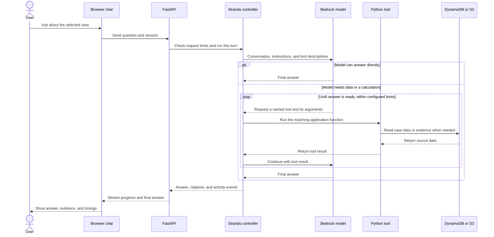

# Agent architecture: synthetic case analyst

## Purpose and boundary

The interactive analyst gives the project a real, variable, multi-step AI-agent
workload. Synthetic commercial-credit cases are only the demo setting. The
project measures request behavior, SLO compliance, and cost; it does not build a
credit product or optimize credit decisions.

The model chooses which read-only tools to call for a user's question. The
application records request, model, tool, session, and memory events outside the
agent's decision process. The UI shows tool activity and evidence, not hidden
chain-of-thought.

## Runtime and interaction

### AWS system architecture

This is the current interview-demo arrangement: the UI and API run locally;
the API uses the AWS SDK credential chain to call AWS services. The waiting line
and metrics live inside that one API process, so multiple copies would each
have their own limits and measurements. In simulated mode, no model is called.
When hosted later, the API can move into an ECS Fargate task; that deployment
is not yet provisioned. CloudWatch applies to that hosted task. The hosted
network path (for example, private ECS tasks and authenticated ingress) is a
later design; it is not drawn as if it already exists.

### Model and tool interaction

**The model is configurable and has not been selected for a live run yet.**
The local default is a scripted simulation, not an LLM. Bedrock mode requires
`BEDROCK_MODEL_ID`. Amazon Nova 2 Lite is the candidate for the first low-volume
tool-use trial; its [model card lists client-side tool calling and response
streaming](https://docs.aws.amazon.com/bedrock/latest/userguide/model-card-amazon-nova-2-lite.html).
The AWS profile's read-only `ListInferenceProfiles` check
showed `us.amazon.nova-2-lite-v1:0` as active in `us-east-1`; this confirms
regional profile listing, not permission to invoke it. Confirm invoke
authorization and pricing before the first paid call. Keep the model ID
configurable so later experiments can compare another model. Bedrock's
Converse API supports model messages and tool configuration; the application
remains responsible for executing its own tools. Check the [Bedrock model feature and
region tables](https://docs.aws.amazon.com/bedrock/latest/userguide/models-supported.html),
[Converse tool-use documentation](https://docs.aws.amazon.com/bedrock/latest/userguide/conversation-inference.html),
and [inference profile availability](https://docs.aws.amazon.com/bedrock/latest/userguide/inference-profiles-support.html)
before selecting the model ID.

The request runs as follows:

1. The user selects one synthetic case and asks a question in the browser.
2. FastAPI checks its waiting line and active-request limit, then passes the
   question and fixed case ID to Strands.
3. Strands sends the conversation, instructions, and available tool
   descriptions to the Bedrock model.
4. The model either returns a text answer or asks to use one or more tools.
   It does not connect directly to DynamoDB or S3.
5. When a tool is requested, Strands calls the matching Python function. The
  function reads the selected case from DynamoDB, reads a limited amount of evidence or
   policy text from S3, or performs a deterministic calculation. The tool
   result goes back to the model, which may request another tool or compose
   the final answer.
6. FastAPI streams visible progress and the final answer to the browser. The
   UI shows tool names, evidence, and timings, never hidden reasoning text.

The case ID is fixed by the selected session; model-generated tool arguments
cannot change the DynamoDB key or choose an arbitrary S3 path. Case facts in
DynamoDB and deterministic calculations are the authoritative values. S3
evidence supports the answer but is treated as untrusted text. Optional
AgentCore Memory can recall and store short same-case notes; it cannot
overwrite source facts or tool results.

- **UI:** existing React/TypeScript chat. A user selects one seeded synthetic
  case, sends a question, sees streamed admission/model/tool events, reviews
  evidence and timings, and can ask a follow-up in the same session.
- **API:** FastAPI exposes `POST /agent/sessions`,
  `POST /agent/sessions/{conversation_id}/turns/stream`, `GET /agent/metrics`,
  `GET /agent/cases`, and `GET /health`.
- **Agent:** Strands runs the conversation between the model and application
  tools. The model can answer directly or ask the application to run one of
  the six listed tools. No LangChain or LangGraph is used.
- **Execution and limits:** each API process runs at most two turns at once
  and holds at most four more in line by default. Strands limits model calls
  to six per question and response text to 900 tokens by default; the
  application allows at most eight tool calls per question and five
  Bedrock-backed questions per process before restart. For a long conversation,
  it sends the latest 20 messages to the model. Bedrock calls have a timeout,
  automatic SDK retries are disabled to avoid silently multiplying calls, and
  each full question has a deadline. These limits help control work, but they
  are not a hard dollar cap. ECS task count, Bedrock quotas, and each process's
  request limits are separate controls.

The separate `/review` API remains a deterministic simulated workload. It is
available for controlled, high-volume local tests; it must not be described as
a live model result.

## Tools and data ownership

| Tool | Source and behavior | Authority |
| --- | --- | --- |
| `get_case_facts` | DynamoDB exact-key `GetItem` for the current case | Authoritative current values |
| `search_case_evidence` | Size-limited S3 JSON read for the current case; returns up to three keyword-ranked excerpts with evidence IDs | Supporting evidence, treated as untrusted text |
| `calculate_dscr` | Deterministic Python calculation from the current case record | Authoritative calculation |
| `run_stress_scenario` | Deterministic calculation for `mild` or `moderate` allowed scenario | Authoritative calculation under named assumption |
| `read_reference_policy` | Reads one configured S3 policy key; key is not model-controlled | Versioned synthetic policy text |
| `evaluate_synthetic_policy` | Fixed demo thresholds and explicit advisory label | Illustrative only; never approves or denies |

The model cannot choose another case ID, S3 key, or DynamoDB table through tool
arguments. Evidence and policy text cannot override system instructions. Tools
are read-only with respect to business data.

## Session and memory

Strands `S3SessionManager` stores and restores the conversation for a stable
conversation ID in an S3 prefix. The browser keeps the same conversation ID for
follow-up turns. Amazon Bedrock AgentCore Memory is an optional same-case
longer-term recall layer; it is supplemental context and never replaces
DynamoDB facts or tool calculations. Memory lookup/write failures are recorded
and fail open. The AgentCore Memory resource and matching namespace strategy
must be created before the integration is enabled.

For this one-user synthetic demo, the case ID scopes AgentCore memory. A
multi-user deployment must derive the memory actor from an authenticated
principal and include case scope in the namespace; it must not share memory
between users. S3 session history also needs an explicit retention/lifecycle
policy before a persistent public deployment.

## Failure behavior and safety

- A missing case is distinct from an unavailable DynamoDB source.
- Evidence/policy source failures are visible as failed tool events. The agent
  may provide a partial answer and must state that the source was unavailable.
- Tool inputs and output sizes are bounded. Unknown stress scenario names
  return a structured tool error.
- Bedrock throttling, unavailable models, exhausted model/tool limits, and
  timeouts are request failures, not successful answers.
- The API returns a generic streamed failure; provider details belong in
  protected server logs, not the browser.
- The app role gets only required Bedrock invocation, DynamoDB `GetItem`, S3
  evidence/policy reads, S3 session-prefix reads/writes, and optional
  AgentCore Memory operations. Local development uses the AWS SDK credential
  chain (for example `AWS_PROFILE`); credentials never go in `.env`.

## Modes and evidence labels

| Mode | Agent/model | State/tools | Result label |
| --- | --- | --- | --- |
| `simulated` (default; legacy `fixture` accepted) | Scripted no-LLM response | Seeded in-memory cases; deterministic delays | `simulated_agent_no_llm` |
| `bedrock` | Strands model-driven loop on Bedrock | DynamoDB, S3, S3 session history, optional AgentCore Memory | `strands_bedrock:<model-id>` |

The simulated agent is the standard load-test path. Do not use uncontrolled real Bedrock
calls as a load generator. Preserve source labels for simulated, recorded, local
live AWS, and deployed AWS evidence.

## AWS target and cost boundary

The interview demo runs on the user's laptop and uses the configured AWS
profile to make low-volume Bedrock and AWS data calls. A Docker image supports a
short-lived ECS Fargate smoke deployment with no public ingress; no resource is
provisioned by the code changes. The model, table, bucket, and AgentCore Memory
resource must be available in the selected region first.

Before the first live integration, estimate the chosen model's token usage,
AgentCore Memory usage, and S3/DynamoDB requests against the agreed $5 ceiling.
Fargate is a separate cost estimate and deployment authorization. No public,
always-on endpoint or high-volume paid inference test is part of this stage.

## Current limitations

- The Bedrock/AWS path is implemented behind configuration but has not been
  verified against a live account or provisioned resources.
- Keyword evidence lookup is a deliberately small S3-backed demonstration,
  not a production retrieval pipeline or vector search system.
- Queue state and metrics are process-local. Multiple tasks do not share an
  admission limit or counters.
- The UI can retain the visible transcript in the current browser session; S3
  session state is the server-side source for resuming the agent conversation.
- Model answer correctness is evaluated only enough to verify tool use,
  citations, and boundaries. It is not the primary project objective.
